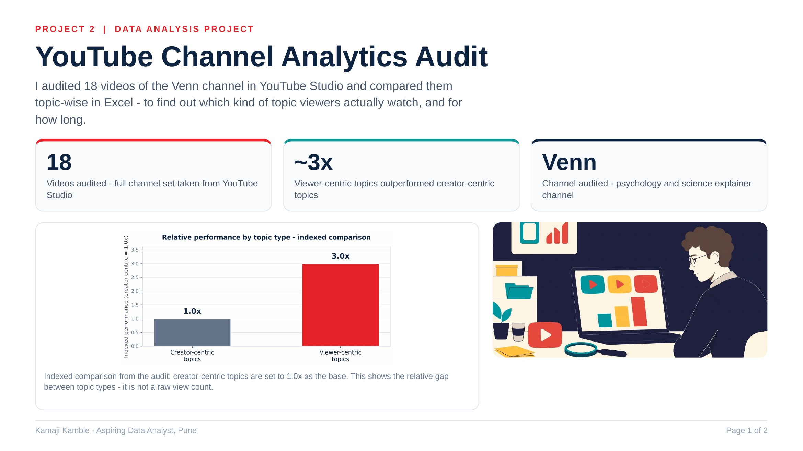
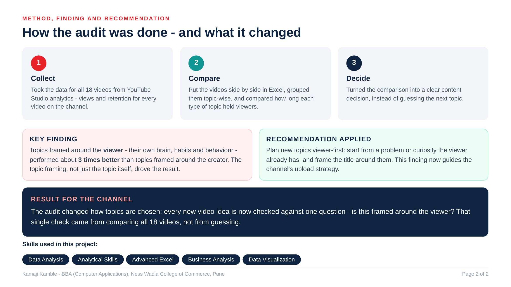

# YouTube Channel Analytics Audit

Audited **18 published videos** on my own channel (@vennshow) using YouTube Studio analytics and spreadsheets, comparing performance by topic type.

## Business question

Which kinds of topics earn more attention — topics about the viewer's own brain and behaviour, or topics about the creator's subject?

## Method

1. Exported per-video views and retention data from YouTube Studio for all 18 published videos (Oct 2026).
2. Classified every video into two topic types:
   - **Viewer-centric** — the topic is about the viewer ("Why Your Brain…", "Why You…")
   - **Creator-centric** — the topic is about the subject itself
3. Compared the two groups in Excel using indexed averages (no single-video numbers are published here).

## Findings

| Topic type | Indexed performance |
| --- | --- |
| Viewer-centric | ~3.0x |
| Creator-centric | 1.0x |

Viewer-centric topics outperformed creator-centric topics by **~3x**.

## What I changed after this audit

- Lead every title with the viewer's experience, not the phenomenon's name.
- Open with a relatable, viewer-first hook in the first 15 seconds.
- Keep the topic framing in the title, thumbnail, and opening line consistent.

## Files

| File | Contents |
| --- | --- |
| `images/youtube-audit-page-1.jpg` | Audit summary — page 1 |
| `images/youtube-audit-page-2.jpg` | Audit summary — page 2 |

## Tools

YouTube Studio, Advanced Excel

## Limitations

- Small sample (18 videos, one channel, one month) — the 3x gap is a directional signal, not a universal rule.
- No per-video view counts are published in this repo.

---
**Author:** Kamaji Kamble — BBA (Computer Applications), Ness Wadia College of Commerce, Pune (2025). Aspiring Data Analyst, Pune.
